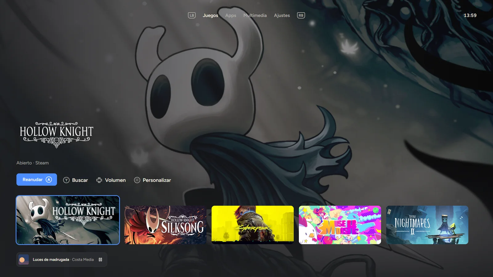
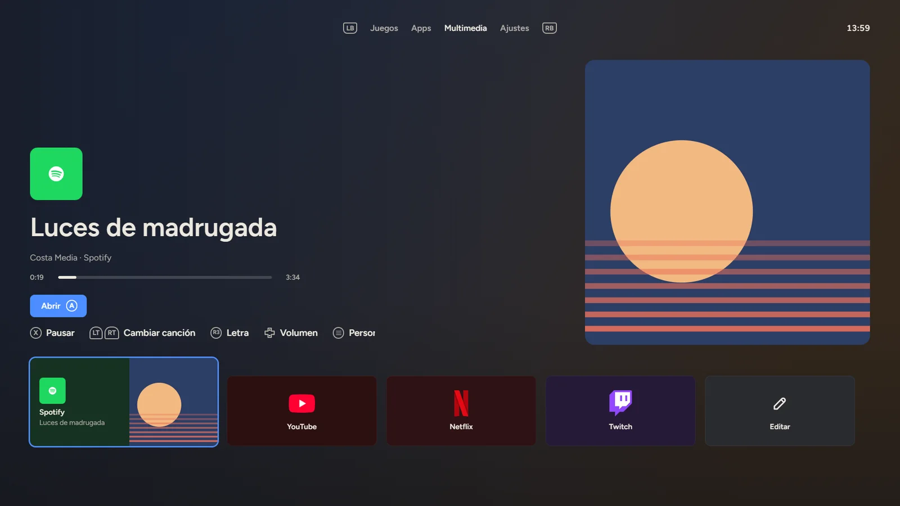
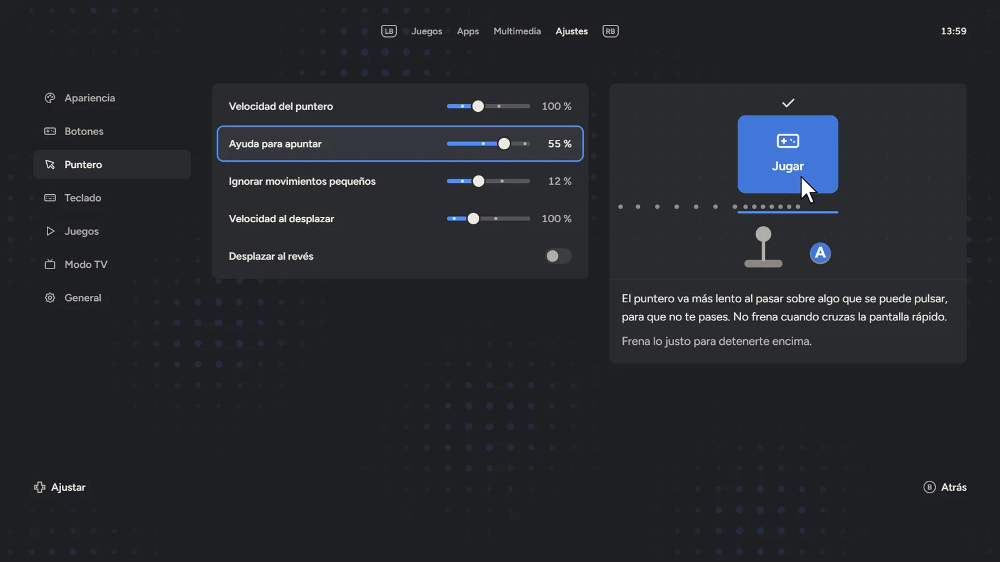
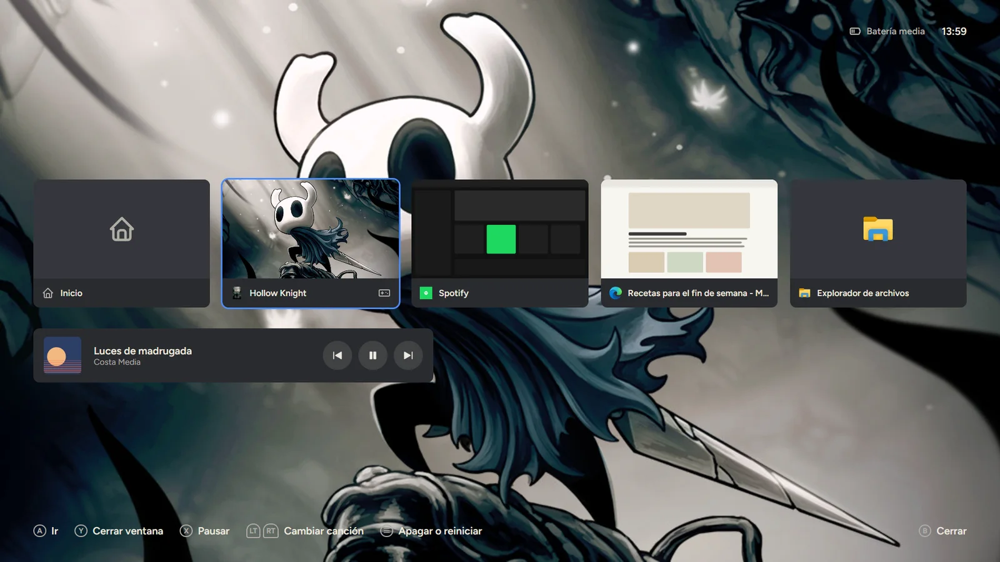

[English](README.md) | Español

# Console UI

Usa todo Windows desde el sillón con el control: un cursor asistido, un teclado en pantalla con sugerencias inteligentes y una pantalla de inicio tipo consola.

[](https://github.com/alenj0x1/console-ui/releases/latest) [](LICENSE) [](https://alenj0x1.github.io/console-ui/) [](https://alenj0x1.github.io/console-ui/docs/es/)

**[Descargar para Windows](https://github.com/alenj0x1/console-ui/releases/latest)** · [Sitio web](https://alenj0x1.github.io/console-ui/) (pruébalo en vivo) · [Documentación](https://alenj0x1.github.io/console-ui/docs/es/)



| Multimedia, con lo que suena | Ajustes, con una vista previa de cada opción | Centro de control, sobre un juego |
|---|---|---|
|  |  |  |

<sub>Capturas de la app con datos de ejemplo. Las imágenes de los juegos pertenecen a sus dueños.</sub>

## Qué hace

- **Cursor asistido**: el stick izquierdo mueve el mouse con una aceleración predecible, frena sobre botones y enlaces (leídos con UI Automation) y se queda quieto un instante al hacer clic. El stick derecho hace scroll y la cruceta envía flechas.
- **Teclado en pantalla**: con Y (o al hacer clic en un campo de texto) se abre sobre cualquier app sin quitarle el foco, en el monitor donde está el cursor y sin tapar lo que se escribe. Cuadrícula QWERTY con ñ, tildes manteniendo el botón, símbolos, y un diseño de dos mitades como opción.
- **Sugerencias**: completan la palabra y ponen la tilde (`esta` → `está`), usan la palabra anterior como contexto y predicen la siguiente. Aprenden de ti, se guardan cifradas con DPAPI y nunca en campos de contraseña. Español por defecto; el inglés se activa desde el teclado.
- **Pantalla de Inicio**: mantén Menu para ver a pantalla completa tus juegos de Steam y Epic (con su arte oficial de fondo), tus apps fijadas con sus íconos reales y una pestaña Multimedia (tus apps de música y video y los sitios de streaming que agregues, con lo que suena primero). De fondo, una animación propia, un fondo de video de Wallpaper Engine o tus videos e imágenes. Al abrir un juego, el control pasa a él.
- **Ajustes**: una pestaña de Inicio para el idioma de la interfaz (español o inglés, al principio el de Windows), el color de acento, el tamaño del texto, los controles, el cursor, el teclado, el modo juego, abrir con Windows y la vibración.
- **Modo juego**: cuando un juego pasa al frente (desde Inicio, Steam o cualquier otro lado), el control es suyo (dos vibraciones cortas), y el cursor vuelve cuando se cierra.
- **Centro de control**: mantén View + Menu (los dos botones pequeños del centro del control: dos cuadritos y tres rayas), incluso en un juego, para ver tus ventanas abiertas y cambiar a una con A (un juego recibe el control; lo demás, el cursor), cerrar una con Y o manejar la música sin salir del juego; B vuelve. En el escritorio también se abre con un toque de View.
- **Modo TV**: deja encendida solo la pantalla de la TV y manda el sonido a ella; al apagarlo todo vuelve como estaba.
- **Bienvenida**: una práctica corta con el control la primera vez.

## Controles

| Control | Modo cursor | Teclado |
|---|---|---|
| Stick izquierdo / cruceta | Mover cursor / flechas | Mover la tecla marcada |
| Stick derecho | Scroll | Mover el punto de escritura |
| A / X / L3 | Clic izquierdo / derecho / central | Escribir (mantener = tilde) / borrar / idiomas |
| B | Esc | Cerrar el teclado |
| Y | Abrir el teclado (también al hacer clic en un campo de texto) | Espacio |
| LB / RB | Atrás / adelante | Mayúscula / símbolos |
| LT | Mantener: puntero lento. Con la cruceta: saltar al botón más cercano | |
| RT | Toque: Intro. Mantener + cruceta: volumen, canción anterior/siguiente | Intro |
| View / Menu | Centro de control (mantener: menú rápido) / menú Inicio (mantener: pantalla de Inicio) | Tomar la primera sugerencia / Intro |
| Mantener View + Menu | Centro de control (también en un juego) | |

## Requisitos

- Windows 10 u 11 (x64) con un control XInput (compatible con Xbox). Los de PlayStation funcionan con Steam Input o DS4Windows.
- WebView2 (incluido en Windows actual; si falta, el instalador lo descarga).
- Opcional: [HidHide](https://github.com/nefarius/HidHide) (MIT), para que el menú Inicio y otras apps de la Tienda no reaccionen al control mientras mueve el cursor. El instalador lo ofrece si no está instalado.

### Instalar

Descarga `Console UI_X.Y.Z_x64-setup.exe` de la [última versión](https://github.com/alenj0x1/console-ui/releases/latest) y ejecútalo. La primera vez, una práctica corta enseña lo básico con el control. La interfaz está en español e inglés (Ajustes › General › Idioma) y de entrada sigue el idioma de Windows.

### Instalador

`Console UI_X.Y.Z_x64-setup.exe` instala solo para el usuario actual (`%LOCALAPPDATA%\Console UI`, sin permisos de administrador), en español o inglés según Windows, con acceso directo en el menú Inicio. Si abres la app otra vez mientras está abierta, aparece la pantalla de Inicio de la que ya corre.

- **HidHide**: una casilla en la primera página, solo si HidHide falta. Descarga la versión oficial (v1.5.230) de GitHub, comprueba su SHA-256 y la firma de Nefarius, y ejecuta el instalador de HidHide, que pide permiso de administrador. Si algo falla, Console UI se instala igual. En una instalación silenciosa se agrega con `/S /HIDHIDE`.
- **Desinstalar** (Configuración de Windows › Aplicaciones): quita la app y su entrada de «abrir con Windows», vuelve a mostrar el control a los juegos y saca a Console UI de la lista de HidHide. Los ajustes, apps fijadas y palabras aprendidas (`%APPDATA%\dev.alejandro.consoleui`) se borran solo si marcas «Eliminar los datos de aplicación». HidHide sigue instalado.

## Desarrollo

```bash
cargo build --release
npm --prefix app ci && npm --prefix app run build   # instalador
```

- `target/release/bundle/nsis/Console UI_X.Y.Z_x64-setup.exe`: el instalador (Tauri CLI; necesita Node.js). Los hooks y el paso de HidHide están en `app/nsis/`.

- `target/release/console-ui.exe`: la app; abre la pantalla de Inicio. `--background` la inicia solo en la bandeja, `--lab` abre el laboratorio del teclado (`--exp=suggest` para comparar sugerencias).
- `target/release/padd.exe`: solo el núcleo de entrada, en consola.
- `target/release/cursor-lab.exe`: el laboratorio del cursor.
- `cargo test`: pruebas unitarias (curvas, almacenamiento cifrado).
- `python -I tools/build_language_data.py`: regenera los datos de sugerencias (descarga fuentes fijadas y verificadas por hash).
- `node labs/keyboard-lab/suggest_eval.js es`: calidad de las sugerencias sin conexión.
- `python scripts/release.py X.Y.Z`: publica una versión (sube versiones, cierra la sección del changelog, hace commit y tag).
- `node scripts/site/build-app.mjs && node scripts/site/serve.mjs`: el sitio en http://localhost:4600 con las pantallas de la app funcionando en vivo (`site/`).
- `npm --prefix docs ci && npm --prefix docs run dev`: la documentación (`docs/`, Astro Starlight).

| Ruta | Qué |
|---|---|
| `crates/padcore` | Núcleo de entrada: XInput, curvas, inyección con SendInput, UI Automation, motor de modos |
| `crates/padd` | Núcleo en consola |
| `app` | App Tauri 2: bandeja, teclado (`app/ui`), ajustes y palabras aprendidas |
| `labs` | Experimentos con datos y notas |
| `tools` | Generadores de datos |
| `docs` | Sitio de documentación (inglés y español) |
| `site` | Sitio web; `site/demo` corre las pantallas de la app con datos de ejemplo |
| `scripts` | Scripts de versiones y del sitio |

## Créditos

- [Tauri](https://tauri.app) (MIT / Apache-2.0), [egui/eframe](https://github.com/emilk/egui) para el laboratorio del cursor (MIT / Apache-2.0), [windows-rs](https://github.com/microsoft/windows-rs) (MIT / Apache-2.0).
- Fuentes [Figtree](https://github.com/erikdkennedy/figtree) y [DM Mono](https://github.com/googlefonts/dm-mono), SIL Open Font License 1.1 (`app/ui/fonts`).
- Listas de palabras derivadas de [FrequencyWords](https://github.com/hermitdave/FrequencyWords) de Hermit Dave (OpenSubtitles 2018), CC BY-SA 4.0. Pares de palabras calculados con frases de [Tatoeba](https://tatoeba.org), CC BY 2.0 FR. Detalle en `app/ui/data/LICENSE-data.txt`.
- Arte de juegos en el sitio y en las capturas: arte oficial de biblioteca de Steam de Hollow Knight, Hollow Knight: Silksong, Cyberpunk 2077, Muse Dash y Little Nightmares II; pertenece a sus dueños.

## Licencia

Código: [MIT](LICENSE). Los datos de sugerencias conservan sus propias licencias (ver Créditos).
