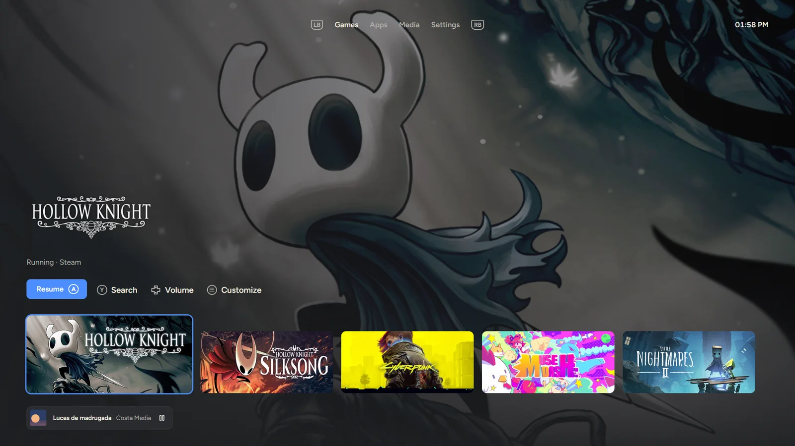
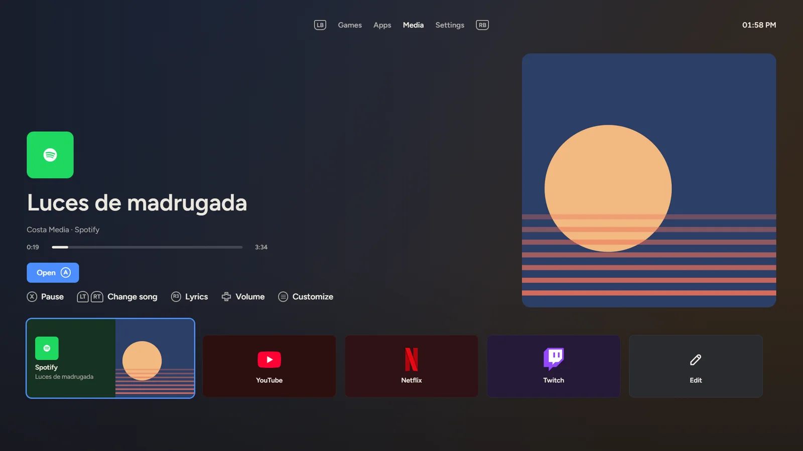
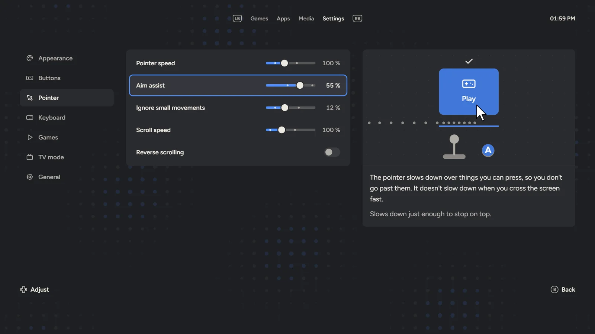
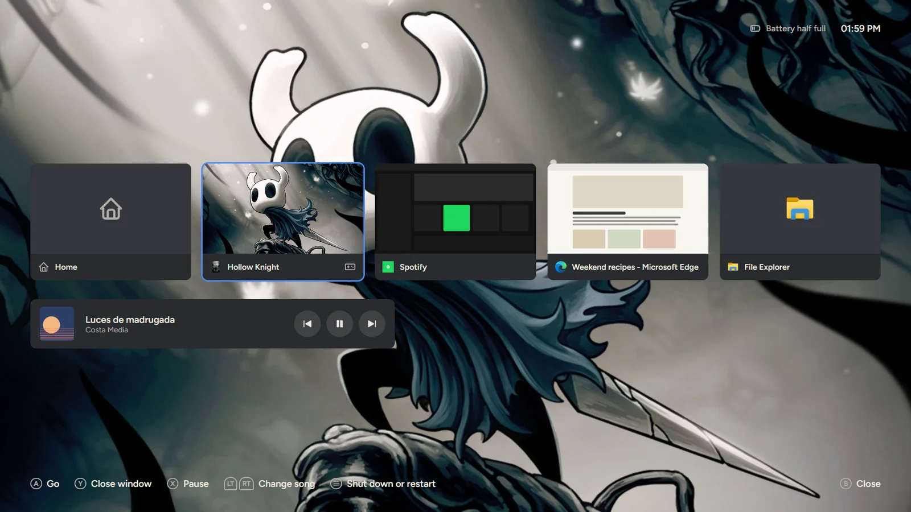

English | [Español](README.es.md)

# Console UI

Use all of Windows from the couch with a game controller: an assisted cursor, an on-screen keyboard with smart suggestions, and a console-style home screen.

[](https://github.com/alenj0x1/console-ui/releases/latest) [](LICENSE) [](https://alenj0x1.github.io/console-ui/) [](https://alenj0x1.github.io/console-ui/docs/)

**[Download for Windows](https://github.com/alenj0x1/console-ui/releases/latest)** · [Website](https://alenj0x1.github.io/console-ui/) (try it live) · [Documentation](https://alenj0x1.github.io/console-ui/docs/)



| Media, with what is playing | Settings, with a preview of each option | Control center, over a game |
|---|---|---|
|  |  |  |

<sub>Screenshots of the app on sample data. Game images belong to their owners.</sub>

## What it does

- **Assisted cursor**: the left stick moves the mouse with a predictable acceleration, slows down over buttons and links (read through UI Automation) and holds still for a moment when you click. Right stick scrolls; the d-pad sends arrow keys.
- **On-screen keyboard**: press Y (or click a text field) to open it over any app without stealing focus, on the monitor under the cursor and clear of the text being typed. QWERTY grid with ñ, accents on hold, symbols, and a two-halves layout as an option.
- **Suggestions**: complete the word and restore accents (`esta` → `está`), use the previous word as context and predict the next one. They learn from you, stored encrypted with DPAPI and never in password fields. Spanish by default; English can be turned on from the keyboard.
- **Home screen**: hold Menu for a full-screen view of your Steam and Epic games (official art as the background), pinned apps with their real icons and a media tab (your media apps and the streaming sites you add, with what is playing first), over a built-in animation, a Wallpaper Engine video wallpaper or your own videos and pictures. Launching a game hands the controller to it.
- **Settings**: a tab on the home screen for the interface language (Spanish or English, Windows' own at first), the accent colour, text size, controls, cursor, keyboard, game mode, starting with Windows and vibration.
- **Game mode**: a game coming to the front (from the home screen, Steam or anywhere else) gets the controller (two short rumbles), and the cursor comes back when it closes.
- **Control center**: hold View + Menu (the two small buttons in the middle of the controller: two squares and three lines), even in a game, to see your open windows and switch to one with A (a game gets the controller, anything else the cursor), close one with Y, or control the music without leaving the game; B goes back. In the desktop, a tap on View opens it too.
- **TV mode**: leaves only the TV's screen on and sends the sound to it; turning it off puts everything back.
- **Welcome**: a short practice with the controller the first time.

## Controls

| Control | Cursor mode | Keyboard |
|---|---|---|
| Left stick / d-pad | Move cursor / arrow keys | Move the highlight |
| Right stick | Scroll | Move the text caret |
| A / X / L3 | Left / right / middle click | Type (hold for accent) / backspace / languages |
| B | Esc | Close the keyboard |
| Y | Open the keyboard (also by clicking a text field) | Space |
| LB / RB | Back / forward | Shift / symbols |
| LT | Hold: slow pointer. With the d-pad: jump to the nearest button | |
| RT | Tap: Enter. Hold + d-pad: volume, previous/next track | Enter |
| View / Menu | Control center (hold: quick menu) / Start menu (hold: home screen) | Take the first suggestion / Enter |
| Hold View + Menu | Control center (also in a game) | |

## Requirements

- Windows 10 or 11 (x64) with an XInput (Xbox-compatible) controller. PlayStation controllers work through Steam Input or DS4Windows.
- WebView2 runtime (included in current Windows; the installer downloads it if it is missing).
- Optional: [HidHide](https://github.com/nefarius/HidHide) (MIT), so the Start menu and other Store apps don't react to the controller while it moves the cursor. The installer offers it when it is not installed.

### Install

Download `Console UI_X.Y.Z_x64-setup.exe` from the [latest release](https://github.com/alenj0x1/console-ui/releases/latest) and run it. The first time, a short practice shows the basics with the controller. The interface is in English and Spanish (Settings › General › Language) and follows Windows by default.

### Installer

`Console UI_X.Y.Z_x64-setup.exe` installs for the current user only (`%LOCALAPPDATA%\Console UI`, no administrator rights), in Spanish or English following Windows, with a Start menu shortcut. Opening the app again while it runs brings up the home screen of the running one.

- **HidHide**: a check box on the first page, shown only when HidHide is missing. It downloads the official release (v1.5.230) from GitHub, checks its SHA-256 and its Nefarius signature, and runs HidHide's own installer, which asks for administrator rights. If anything fails, Console UI still installs. Silent installs add it with `/S /HIDHIDE`.
- **Uninstall** (Windows Settings › Apps): removes the app and its "start with Windows" entry, shows the controller to games again and takes Console UI off HidHide's list. Settings, pinned apps and learned words (`%APPDATA%\dev.alejandro.consoleui`) are deleted only if "Delete the application data" is checked. HidHide stays installed.

## Development

```bash
cargo build --release
npm --prefix app ci && npm --prefix app run build   # installer
```

- `target/release/bundle/nsis/Console UI_X.Y.Z_x64-setup.exe`: the installer (Tauri CLI; needs Node.js). Hooks and the HidHide step live in `app/nsis/`.

- `target/release/console-ui.exe`: the app; it opens the home screen. `--background` starts it in the tray only, `--lab` opens the keyboard lab (`--exp=suggest` for the suggestions comparison).
- `target/release/padd.exe`: the input core alone, in a console.
- `target/release/cursor-lab.exe`: the cursor lab.
- `cargo test`: unit tests (curves, encrypted store).
- `python -I tools/build_language_data.py`: rebuilds the suggestion data (downloads pinned, hash-checked sources).
- `node labs/keyboard-lab/suggest_eval.js es`: offline suggestion quality.
- `python scripts/release.py X.Y.Z`: cuts a release (bumps versions, closes the changelog section, commits and tags).
- `node scripts/site/build-app.mjs && node scripts/site/serve.mjs`: the website at http://localhost:4600 with the app's pages running live (`site/`).
- `npm --prefix docs ci && npm --prefix docs run dev`: the documentation (`docs/`, Astro Starlight).

| Path | What |
|---|---|
| `crates/padcore` | Input core: XInput, stick curves, SendInput injection, UI Automation, mode engine |
| `crates/padd` | Console host for the core |
| `app` | Tauri 2 app: tray, keyboard overlay (`app/ui`), settings and learned words |
| `labs` | Experiments with data and notes |
| `tools` | Data builders |
| `docs` | Documentation site (English and Spanish) |
| `site` | Website; `site/demo` runs the app's pages on sample data |
| `scripts` | Release and website scripts |

## Credits

- [Tauri](https://tauri.app) (MIT / Apache-2.0), [egui/eframe](https://github.com/emilk/egui) for the cursor lab (MIT / Apache-2.0), [windows-rs](https://github.com/microsoft/windows-rs) (MIT / Apache-2.0).
- Fonts [Figtree](https://github.com/erikdkennedy/figtree) and [DM Mono](https://github.com/googlefonts/dm-mono), SIL Open Font License 1.1 (`app/ui/fonts`).
- Word lists derived from [FrequencyWords](https://github.com/hermitdave/FrequencyWords) by Hermit Dave (OpenSubtitles 2018), CC BY-SA 4.0. Word pairs computed from [Tatoeba](https://tatoeba.org) sentences, CC BY 2.0 FR. Details in `app/ui/data/LICENSE-data.txt`.
- Game art on the website and in the screenshots: official Steam library art of Hollow Knight, Hollow Knight: Silksong, Cyberpunk 2077, Muse Dash and Little Nightmares II; it belongs to their owners.

## License

Code: [MIT](LICENSE). Suggestion data keeps its own licenses (see Credits).
